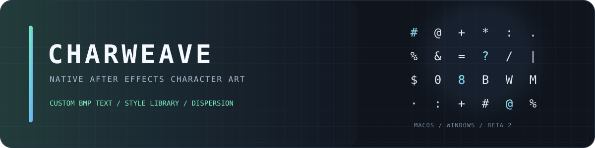

# EdgeViz — After Effects effect plug-in

**English** | [简体中文](README.zh-CN.md)

**v0.1.1** · match name `com.edgeviz.outline` · target: After Effects 23–26 · macOS Intel/Apple Silicon + Windows x64

EdgeViz overlays layer bounds, text glyphs, shape paths, Bézier vertices/handles, mask silhouettes, motion paths, and nested precomp geometry. The effect match name and all 39 persisted parameter IDs are unchanged from v0.1.0.

<div align="center">



[](https://github.com/luoboruodai/EdgeViz/actions/workflows/charweave.yml)

</div>

## CharWeave companion plug-in · separate beta

This repository also hosts **CharWeave Native 0.4.4 beta 2**, a separate character-art effect. It does not replace EdgeViz and uses a distinct effect match name and release tag.

| Product | Status | Platforms |
| --- | --- | --- |
| EdgeViz | Stable `v0.1.1` | macOS universal · Windows x64 |
| CharWeave | Prerelease `0.4.4 beta 2` | macOS universal · Windows x64 candidate |

- [Download CharWeave macOS universal ZIP](https://github.com/luoboruodai/EdgeViz/releases/download/charweave-v0.4.4-beta.2/CharWeave-0.4.4-b2-macOS.zip)
- [Download CharWeave Windows x64 ZIP](https://github.com/luoboruodai/EdgeViz/releases/download/charweave-v0.4.4-beta.2/CharWeave-0.4.4-b2-Windows-x64.zip)
- [SHA-256 checksums](https://github.com/luoboruodai/EdgeViz/releases/download/charweave-v0.4.4-beta.2/SHA256SUMS.txt) · [Release notes](charweave/docs/RELEASE-0.4.4-beta.2.md)
- [Source and verification](charweave/README.md) · [Install guide](charweave/docs/INSTALL.en.md) · [中文指南](charweave/docs/INSTALL.zh-CN.md)

**The stable EdgeViz release remains v0.1.1.** CharWeave is a namespaced prerelease, not an EdgeViz upgrade. The EdgeViz instructions below remain unchanged. Windows host acceptance for CharWeave is still pending.

## Downloads

- `EdgeViz-v0.1.1-macOS-universal.zip` — `EdgeViz.plugin`, both `arm64` and `x86_64` slices, ad-hoc signed.
- `EdgeViz-v0.1.1-Windows-x64.zip` — `EdgeViz.aex`, PE32+ Windows x64 DLL.
- `SHA256SUMS.txt` — hashes for those two downloadable ZIPs.

The previous v0.1.0 **Windows** binary is superseded. Do not install both an older `EdgeViz Outline` copy and the new `EdgeViz` copy: they share one match name.

## Install

1. **Quit After Effects completely.** Remove any earlier EdgeViz/EdgeViz Outline binary from the appropriate `MediaCore` directory, including duplicate copies in version-specific plug-in folders.
2. On macOS, copy the entire `EdgeViz.plugin` folder to `~/Library/Application Support/Adobe/Common/Plug-ins/7.0/MediaCore/`.
3. On Windows x64, copy `EdgeViz.aex` to `C:\Program Files\Adobe\Common\Plug-ins\7.0\MediaCore\` (administrator permission may be needed).
4. Restart AE. If it crashes while scanning plug-ins, remove `EdgeViz.aex` to recover and send the AE/Windows version and crash dump to the maintainer. The path shown in the crash dialog points to a **scan directory**, not necessarily the exact failing module.

Uninstall by removing that single plug-in copy and restarting AE. The macOS bundle is ad-hoc signed, **not notarized**; the Windows binary has **no Authenticode signature**.

## Verification and compatibility limits

- macOS: the universal binary, both PiPL architecture entries, bundle signature, and one-frame rendering of the supplied `EV_Test` project in **AE 26.5 on Apple Silicon** passed.
- Windows: the PE x64 machine type, loader imports, `EffectMain` export, version resource, complete big-endian PiPL payload, exact-case `PiPL` resource type, entry key `8664`, ID 16000, and ZIP integrity passed static checks. A script to test actual Windows OS loading is provided at `test/smoke_windows_load.py`.
- **AE 23, 24, 25 and Windows AE 23–26 have not been tested on their respective hosts.** Targeting their APIs does not establish runtime compatibility. Test plug-in loading, applying the effect, reopening an older project, and rendering on *each* target AE version before a deployment claim. Windows on Arm native AE requires a separate ARM64 build; this package is x64 only.

The current build uses older CS6-compatible Adobe headers with MinGW-w64 for Windows. Adobe recommends building with recent SDK headers and testing every claimed host version; an MSVC/modern SDK rebuild and real Windows AE regression remain recommended before production use. See `windows/README.md` for a validation matrix.

## Build and checks

The public repository excludes the licensed Adobe SDK. Set `AE_SDK_ROOT` to your own SDK checkout, then run from the repository root:

```bash
AE_SDK_ROOT=/path/to/AdobeSDK ./build.sh       # macOS universal, requires Xcode tools
AE_SDK_ROOT=/path/to/AdobeSDK ./build_win.sh   # Windows x64 cross-build, requires MinGW-w64
python3 scripts/package_release.py
python3 test/check_params.py
python3 test/check_windows_binary.py
python3 test/check_version.py
python3 test/check_release.py
```

Repository: `luoboruodai/EdgeViz` · release tag: `v0.1.1`.
